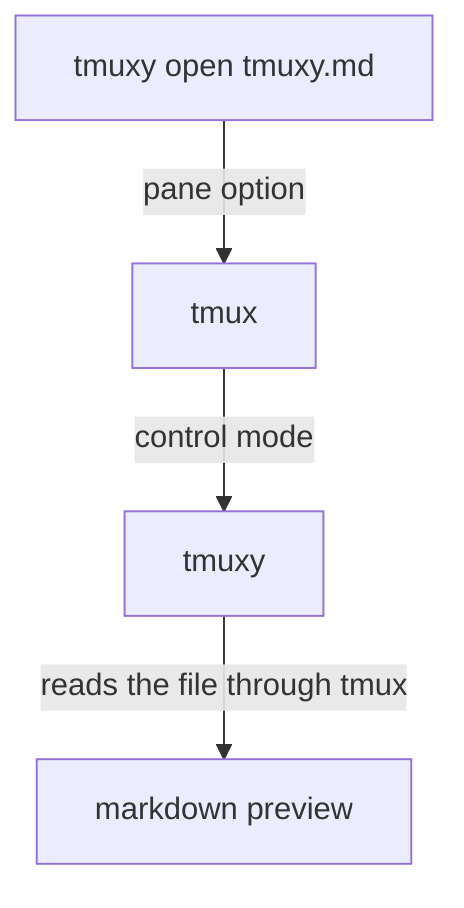

# Markdown in tmux?

How is this possible?

This pane ran `tmuxy open tmuxy.md`. The command tells tmux which file the
pane previews, and tmuxy reads that file through tmux and renders it instead
of the terminal grid. It follows the file as it changes, and Ctrl+C gives
the shell back.

The **nyan cat GIF** on the left pane is no widget at all: a script prints it
with the Kitty graphics protocol, tmux passes it through, and tmuxy draws the
picture. Any program that speaks Kitty graphics, iTerm2 images or Sixel shows
its pictures the same way, still inside tmux.

Anything you can render in React, you can render in a pane.

